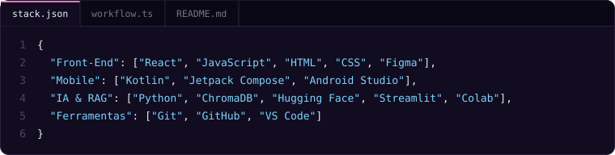
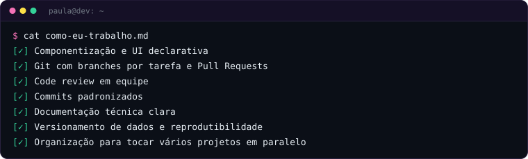
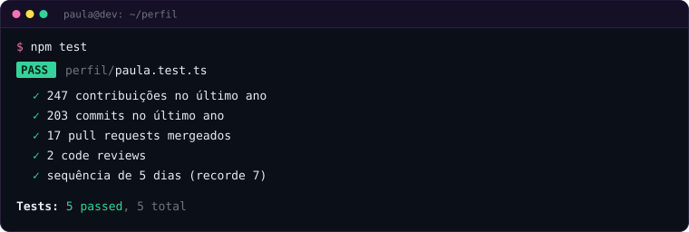

<!-- ==================== CABEÇALHO ==================== -->
<p align="center">
  
</p>

<p align="center">
  
</p>

<!-- 👇 Se quiser o banner do quarto roxo, cole a linha dele aqui embaixo -->


<!-- ==================== SOBRE MIM ==================== -->
<p>
Desenvolvedora Front-End que gosta de transformar ideias em interfaces bonitas, acessíveis e bem construídas.
Venho do desenvolvimento Android com Kotlin e Jetpack Compose — e levo para a web a mesma forma de pensar em componentes e UI declarativa.
Como diferencial, trago experiência prática com IA Generativa e RAG para criar aplicações mais inteligentes. 💜
</p>

👩‍💻 &nbsp;Desenvolvedora Front-End <br/>
⚛️ &nbsp;React.js · JavaScript · HTML & CSS <br/>
📱 &nbsp;Background em Android com Kotlin & Jetpack Compose <br/>
✨ &nbsp;Diferencial: IA Generativa & RAG aplicados a interfaces <br/>
🧠 &nbsp;Formação em IA & RAG pelo Instituto ECOA (PUC-Rio) <br/>
🔎 &nbsp;Experiência prática com RAG aplicado à saúde pública <br/>
🎓 &nbsp;Especialização em Inteligência Artificial <br/>

```bash
> Desenvolvendo soluções. Criando experiências. Evoluindo sempre. </>
```


<!-- ==================== TECNOLOGIAS ==================== -->
### 🚀 Tecnologias & Ferramentas

<p align="center">
  
</p>


<!-- ==================== COMO EU TRABALHO ==================== -->
### ⚙️ Como eu trabalho

<p align="center">
  
</p>


<!-- ==================== GITHUB STATS ==================== -->
### 📊 GitHub Stats

<p align="center">
  
</p>


<!-- ==================== CONTRIBUIÇÕES ==================== -->
### 🏙️ Contribuições

<p align="center">
  
</p>


<!-- ==================== ARCADE ==================== -->
### 🎮 Arcade da Paula

<p align="center">
  <a href="https://paula-thamyres.github.io/Paula-Thamyres/jogar/">
    
  </a>
</p>

<p align="center">
  <a href="https://paula-thamyres.github.io/Paula-Thamyres/jogar/">
    
  </a>
</p>

<p align="center"><sub>Quiz de JavaScript · Memória Dev · Xadrez Candy — feitos por mim com HTML, CSS e JavaScript 💜</sub></p>


<!-- ==================== CONTATO ==================== -->
### 📡 Vamos nos conectar?

<p align="center">
  <a href="https://www.linkedin.com/in/paula-femina">
    
  </a>
  <a href="mailto:paula.arthamys@gmail.com">
    
  </a>
</p>

<p align="center">
  
</p>
