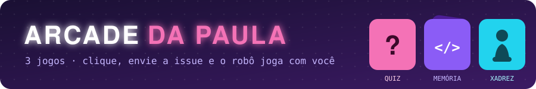
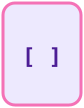
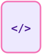
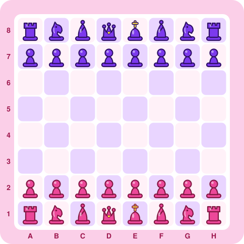

<!-- ==================== CABEÇALHO ==================== -->
<p align="center">👋 Olá, eu sou</p>

<p align="center">
  
</p>

<p align="center">
  
</p>

<!-- 👇 COLE AQUI A LINHA DO SEU BANNER (a imagem do quarto roxo) -->

<p align="center">
  
</p>

<!-- ==================== SOBRE MIM ==================== -->
<p>
Desenvolvedora Front-End que gosta de transformar ideias em interfaces bonitas, acessíveis e bem construídas.
Venho do desenvolvimento Android com Kotlin e Jetpack Compose — e levo para a web a mesma forma de pensar em componentes e UI declarativa.
Como diferencial, trago experiência prática com IA Generativa e RAG para criar aplicações mais inteligentes. 💜
</p>

👩‍💻 &nbsp;Desenvolvedora Front-End <br/>
⚛️ &nbsp;React.js · JavaScript · HTML & CSS <br/>
📱 &nbsp;Background em Android com Kotlin & Jetpack Compose <br/>
✨ &nbsp;Diferencial: IA Generativa & RAG aplicados a interfaces <br/>
🧠 &nbsp;Formação em IA & RAG pelo Instituto ECOA (PUC-Rio) <br/>
🔎 &nbsp;Experiência prática com RAG aplicado à saúde pública <br/>
🎓 &nbsp;Especialização em Inteligência Artificial <br/>

```bash
> Desenvolvendo soluções. Criando experiências. Evoluindo sempre. </>
```


<!-- ==================== TECNOLOGIAS + COMO EU TRABALHO ==================== -->
<table>
<tr>
<td valign="top" width="58%">

### 🚀 Tecnologias & Ferramentas

**Front-End**<br/>


**Mobile**<br/>


**IA & RAG**<br/>


**Ferramentas**<br/>


</td>
<td valign="top" width="42%">

### 🤝 Como eu trabalho

💜 Componentização e UI declarativa <br/>
💜 Git com branches por tarefa e Pull Requests <br/>
💜 Code review em equipe <br/>
💜 Commits padronizados <br/>
💜 Documentação técnica clara <br/>
💜 Versionamento de dados e reprodutibilidade <br/>
💜 Aprendizado contínuo, um projeto de cada vez

</td>
</tr>
</table>


<!-- ==================== GITHUB STATS ==================== -->
### 📊 GitHub Stats

<p align="center">
  
  
  
</p>


<!-- ==================== ARCADE ==================== -->
### 🎮 Arcade da Paula

<p align="center"></p>

<p align="center"><sub>Programei estes jogos com Python e GitHub Actions. Clique numa jogada, envie a issue que abrir e, em uns 30 segundos, o robô atualiza o perfil. Todo mundo pode jogar! 💜</sub></p>

<details open>
<summary><b>🧠 Quiz de JavaScript</b> · responda e ganhe pontos</summary>
<br>

<!-- ARCADE:QUIZ:INICIO -->
<p align="center"></p>
<p align="center"><a href="https://github.com/Paula-Thamyres/Paula-Thamyres/issues/new?title=arcade%7Cquiz%7CA&body=S%C3%B3%20clicar%20em%20%2A%2ACreate%2A%2A%20%28ou%20%2A%2ASubmit%20new%20issue%2A%2A%29%20aqui%20embaixo.%20Em%20uns%2030%20segundos%20o%20rob%C3%B4%20faz%20a%20jogada%2C%20atualiza%20o%20perfil%20e%20fecha%20esta%20issue.%20%F0%9F%92%9C"></a> <a href="https://github.com/Paula-Thamyres/Paula-Thamyres/issues/new?title=arcade%7Cquiz%7CB&body=S%C3%B3%20clicar%20em%20%2A%2ACreate%2A%2A%20%28ou%20%2A%2ASubmit%20new%20issue%2A%2A%29%20aqui%20embaixo.%20Em%20uns%2030%20segundos%20o%20rob%C3%B4%20faz%20a%20jogada%2C%20atualiza%20o%20perfil%20e%20fecha%20esta%20issue.%20%F0%9F%92%9C"></a><br><a href="https://github.com/Paula-Thamyres/Paula-Thamyres/issues/new?title=arcade%7Cquiz%7CC&body=S%C3%B3%20clicar%20em%20%2A%2ACreate%2A%2A%20%28ou%20%2A%2ASubmit%20new%20issue%2A%2A%29%20aqui%20embaixo.%20Em%20uns%2030%20segundos%20o%20rob%C3%B4%20faz%20a%20jogada%2C%20atualiza%20o%20perfil%20e%20fecha%20esta%20issue.%20%F0%9F%92%9C"></a> <a href="https://github.com/Paula-Thamyres/Paula-Thamyres/issues/new?title=arcade%7Cquiz%7CD&body=S%C3%B3%20clicar%20em%20%2A%2ACreate%2A%2A%20%28ou%20%2A%2ASubmit%20new%20issue%2A%2A%29%20aqui%20embaixo.%20Em%20uns%2030%20segundos%20o%20rob%C3%B4%20faz%20a%20jogada%2C%20atualiza%20o%20perfil%20e%20fecha%20esta%20issue.%20%F0%9F%92%9C"></a></p>

<p align="center">✅ <b>@Paula-Thamyres</b> acertou a pergunta 1: <code>&quot;object&quot;</code><br><sub>1 pergunta respondida pela comunidade</sub></p>
<!-- ARCADE:QUIZ:FIM -->

</details>

<details open>
<summary><b>🃏 Memória Dev</b> · encontre os pares de código</summary>
<br>

<!-- ARCADE:MEMORIA:INICIO -->
<p align="center"><a href="https://github.com/Paula-Thamyres/Paula-Thamyres/issues/new?title=arcade%7Cmemoria%7C0&body=S%C3%B3%20clicar%20em%20%2A%2ACreate%2A%2A%20%28ou%20%2A%2ASubmit%20new%20issue%2A%2A%29%20aqui%20embaixo.%20Em%20uns%2030%20segundos%20o%20rob%C3%B4%20faz%20a%20jogada%2C%20atualiza%20o%20perfil%20e%20fecha%20esta%20issue.%20%F0%9F%92%9C"></a><a href="https://github.com/Paula-Thamyres/Paula-Thamyres/issues/new?title=arcade%7Cmemoria%7C2&body=S%C3%B3%20clicar%20em%20%2A%2ACreate%2A%2A%20%28ou%20%2A%2ASubmit%20new%20issue%2A%2A%29%20aqui%20embaixo.%20Em%20uns%2030%20segundos%20o%20rob%C3%B4%20faz%20a%20jogada%2C%20atualiza%20o%20perfil%20e%20fecha%20esta%20issue.%20%F0%9F%92%9C"></a><a href="https://github.com/Paula-Thamyres/Paula-Thamyres/issues/new?title=arcade%7Cmemoria%7C4&body=S%C3%B3%20clicar%20em%20%2A%2ACreate%2A%2A%20%28ou%20%2A%2ASubmit%20new%20issue%2A%2A%29%20aqui%20embaixo.%20Em%20uns%2030%20segundos%20o%20rob%C3%B4%20faz%20a%20jogada%2C%20atualiza%20o%20perfil%20e%20fecha%20esta%20issue.%20%F0%9F%92%9C"></a><a href="https://github.com/Paula-Thamyres/Paula-Thamyres/issues/new?title=arcade%7Cmemoria%7C5&body=S%C3%B3%20clicar%20em%20%2A%2ACreate%2A%2A%20%28ou%20%2A%2ASubmit%20new%20issue%2A%2A%29%20aqui%20embaixo.%20Em%20uns%2030%20segundos%20o%20rob%C3%B4%20faz%20a%20jogada%2C%20atualiza%20o%20perfil%20e%20fecha%20esta%20issue.%20%F0%9F%92%9C"></a><a href="https://github.com/Paula-Thamyres/Paula-Thamyres/issues/new?title=arcade%7Cmemoria%7C6&body=S%C3%B3%20clicar%20em%20%2A%2ACreate%2A%2A%20%28ou%20%2A%2ASubmit%20new%20issue%2A%2A%29%20aqui%20embaixo.%20Em%20uns%2030%20segundos%20o%20rob%C3%B4%20faz%20a%20jogada%2C%20atualiza%20o%20perfil%20e%20fecha%20esta%20issue.%20%F0%9F%92%9C"></a><a href="https://github.com/Paula-Thamyres/Paula-Thamyres/issues/new?title=arcade%7Cmemoria%7C7&body=S%C3%B3%20clicar%20em%20%2A%2ACreate%2A%2A%20%28ou%20%2A%2ASubmit%20new%20issue%2A%2A%29%20aqui%20embaixo.%20Em%20uns%2030%20segundos%20o%20rob%C3%B4%20faz%20a%20jogada%2C%20atualiza%20o%20perfil%20e%20fecha%20esta%20issue.%20%F0%9F%92%9C"></a><br><a href="https://github.com/Paula-Thamyres/Paula-Thamyres/issues/new?title=arcade%7Cmemoria%7C8&body=S%C3%B3%20clicar%20em%20%2A%2ACreate%2A%2A%20%28ou%20%2A%2ASubmit%20new%20issue%2A%2A%29%20aqui%20embaixo.%20Em%20uns%2030%20segundos%20o%20rob%C3%B4%20faz%20a%20jogada%2C%20atualiza%20o%20perfil%20e%20fecha%20esta%20issue.%20%F0%9F%92%9C"></a><a href="https://github.com/Paula-Thamyres/Paula-Thamyres/issues/new?title=arcade%7Cmemoria%7C9&body=S%C3%B3%20clicar%20em%20%2A%2ACreate%2A%2A%20%28ou%20%2A%2ASubmit%20new%20issue%2A%2A%29%20aqui%20embaixo.%20Em%20uns%2030%20segundos%20o%20rob%C3%B4%20faz%20a%20jogada%2C%20atualiza%20o%20perfil%20e%20fecha%20esta%20issue.%20%F0%9F%92%9C"></a><a href="https://github.com/Paula-Thamyres/Paula-Thamyres/issues/new?title=arcade%7Cmemoria%7C10&body=S%C3%B3%20clicar%20em%20%2A%2ACreate%2A%2A%20%28ou%20%2A%2ASubmit%20new%20issue%2A%2A%29%20aqui%20embaixo.%20Em%20uns%2030%20segundos%20o%20rob%C3%B4%20faz%20a%20jogada%2C%20atualiza%20o%20perfil%20e%20fecha%20esta%20issue.%20%F0%9F%92%9C"></a><a href="https://github.com/Paula-Thamyres/Paula-Thamyres/issues/new?title=arcade%7Cmemoria%7C11&body=S%C3%B3%20clicar%20em%20%2A%2ACreate%2A%2A%20%28ou%20%2A%2ASubmit%20new%20issue%2A%2A%29%20aqui%20embaixo.%20Em%20uns%2030%20segundos%20o%20rob%C3%B4%20faz%20a%20jogada%2C%20atualiza%20o%20perfil%20e%20fecha%20esta%20issue.%20%F0%9F%92%9C"></a><a href="https://github.com/Paula-Thamyres/Paula-Thamyres/issues/new?title=arcade%7Cmemoria%7C12&body=S%C3%B3%20clicar%20em%20%2A%2ACreate%2A%2A%20%28ou%20%2A%2ASubmit%20new%20issue%2A%2A%29%20aqui%20embaixo.%20Em%20uns%2030%20segundos%20o%20rob%C3%B4%20faz%20a%20jogada%2C%20atualiza%20o%20perfil%20e%20fecha%20esta%20issue.%20%F0%9F%92%9C"></a><a href="https://github.com/Paula-Thamyres/Paula-Thamyres/issues/new?title=arcade%7Cmemoria%7C13&body=S%C3%B3%20clicar%20em%20%2A%2ACreate%2A%2A%20%28ou%20%2A%2ASubmit%20new%20issue%2A%2A%29%20aqui%20embaixo.%20Em%20uns%2030%20segundos%20o%20rob%C3%B4%20faz%20a%20jogada%2C%20atualiza%20o%20perfil%20e%20fecha%20esta%20issue.%20%F0%9F%92%9C"></a><a href="https://github.com/Paula-Thamyres/Paula-Thamyres/issues/new?title=arcade%7Cmemoria%7C14&body=S%C3%B3%20clicar%20em%20%2A%2ACreate%2A%2A%20%28ou%20%2A%2ASubmit%20new%20issue%2A%2A%29%20aqui%20embaixo.%20Em%20uns%2030%20segundos%20o%20rob%C3%B4%20faz%20a%20jogada%2C%20atualiza%20o%20perfil%20e%20fecha%20esta%20issue.%20%F0%9F%92%9C"></a><a href="https://github.com/Paula-Thamyres/Paula-Thamyres/issues/new?title=arcade%7Cmemoria%7C15&body=S%C3%B3%20clicar%20em%20%2A%2ACreate%2A%2A%20%28ou%20%2A%2ASubmit%20new%20issue%2A%2A%29%20aqui%20embaixo.%20Em%20uns%2030%20segundos%20o%20rob%C3%B4%20faz%20a%20jogada%2C%20atualiza%20o%20perfil%20e%20fecha%20esta%20issue.%20%F0%9F%92%9C"></a></p>

<p align="center"><b>Pares:</b> 0/8 · <b>Jogadas:</b> 1<br>😅 <b>@Paula-Thamyres</b> virou <code>[ ]</code> e <code>&lt;/&gt;</code>: não formam par. Elas desviram na próxima jogada.</p>
<!-- ARCADE:MEMORIA:FIM -->

</details>

<details open>
<summary><b>♟️ Xadrez Candy</b> · uma partida aberta para todo mundo</summary>
<br>

<!-- ARCADE:XADREZ:INICIO -->
<p align="center"></p>

<p align="center">🩷 <b>Vez das rosas</b> · lance 1<br>Qualquer pessoa pode jogar: escolha um lance abaixo 👇</p>

<table align="center">
<tr><th>Peça</th><th>De</th><th>Para (clique)</th></tr>
<tr><td>Peão</td><td><b>A2</b></td><td><a href="https://github.com/Paula-Thamyres/Paula-Thamyres/issues/new?title=arcade%7Cxadrez%7CA2A3&body=S%C3%B3%20clicar%20em%20%2A%2ACreate%2A%2A%20%28ou%20%2A%2ASubmit%20new%20issue%2A%2A%29%20aqui%20embaixo.%20Em%20uns%2030%20segundos%20o%20rob%C3%B4%20faz%20a%20jogada%2C%20atualiza%20o%20perfil%20e%20fecha%20esta%20issue.%20%F0%9F%92%9C">A3</a> · <a href="https://github.com/Paula-Thamyres/Paula-Thamyres/issues/new?title=arcade%7Cxadrez%7CA2A4&body=S%C3%B3%20clicar%20em%20%2A%2ACreate%2A%2A%20%28ou%20%2A%2ASubmit%20new%20issue%2A%2A%29%20aqui%20embaixo.%20Em%20uns%2030%20segundos%20o%20rob%C3%B4%20faz%20a%20jogada%2C%20atualiza%20o%20perfil%20e%20fecha%20esta%20issue.%20%F0%9F%92%9C">A4</a></td></tr>
<tr><td>Peão</td><td><b>B2</b></td><td><a href="https://github.com/Paula-Thamyres/Paula-Thamyres/issues/new?title=arcade%7Cxadrez%7CB2B3&body=S%C3%B3%20clicar%20em%20%2A%2ACreate%2A%2A%20%28ou%20%2A%2ASubmit%20new%20issue%2A%2A%29%20aqui%20embaixo.%20Em%20uns%2030%20segundos%20o%20rob%C3%B4%20faz%20a%20jogada%2C%20atualiza%20o%20perfil%20e%20fecha%20esta%20issue.%20%F0%9F%92%9C">B3</a> · <a href="https://github.com/Paula-Thamyres/Paula-Thamyres/issues/new?title=arcade%7Cxadrez%7CB2B4&body=S%C3%B3%20clicar%20em%20%2A%2ACreate%2A%2A%20%28ou%20%2A%2ASubmit%20new%20issue%2A%2A%29%20aqui%20embaixo.%20Em%20uns%2030%20segundos%20o%20rob%C3%B4%20faz%20a%20jogada%2C%20atualiza%20o%20perfil%20e%20fecha%20esta%20issue.%20%F0%9F%92%9C">B4</a></td></tr>
<tr><td>Peão</td><td><b>C2</b></td><td><a href="https://github.com/Paula-Thamyres/Paula-Thamyres/issues/new?title=arcade%7Cxadrez%7CC2C3&body=S%C3%B3%20clicar%20em%20%2A%2ACreate%2A%2A%20%28ou%20%2A%2ASubmit%20new%20issue%2A%2A%29%20aqui%20embaixo.%20Em%20uns%2030%20segundos%20o%20rob%C3%B4%20faz%20a%20jogada%2C%20atualiza%20o%20perfil%20e%20fecha%20esta%20issue.%20%F0%9F%92%9C">C3</a> · <a href="https://github.com/Paula-Thamyres/Paula-Thamyres/issues/new?title=arcade%7Cxadrez%7CC2C4&body=S%C3%B3%20clicar%20em%20%2A%2ACreate%2A%2A%20%28ou%20%2A%2ASubmit%20new%20issue%2A%2A%29%20aqui%20embaixo.%20Em%20uns%2030%20segundos%20o%20rob%C3%B4%20faz%20a%20jogada%2C%20atualiza%20o%20perfil%20e%20fecha%20esta%20issue.%20%F0%9F%92%9C">C4</a></td></tr>
<tr><td>Peão</td><td><b>D2</b></td><td><a href="https://github.com/Paula-Thamyres/Paula-Thamyres/issues/new?title=arcade%7Cxadrez%7CD2D3&body=S%C3%B3%20clicar%20em%20%2A%2ACreate%2A%2A%20%28ou%20%2A%2ASubmit%20new%20issue%2A%2A%29%20aqui%20embaixo.%20Em%20uns%2030%20segundos%20o%20rob%C3%B4%20faz%20a%20jogada%2C%20atualiza%20o%20perfil%20e%20fecha%20esta%20issue.%20%F0%9F%92%9C">D3</a> · <a href="https://github.com/Paula-Thamyres/Paula-Thamyres/issues/new?title=arcade%7Cxadrez%7CD2D4&body=S%C3%B3%20clicar%20em%20%2A%2ACreate%2A%2A%20%28ou%20%2A%2ASubmit%20new%20issue%2A%2A%29%20aqui%20embaixo.%20Em%20uns%2030%20segundos%20o%20rob%C3%B4%20faz%20a%20jogada%2C%20atualiza%20o%20perfil%20e%20fecha%20esta%20issue.%20%F0%9F%92%9C">D4</a></td></tr>
<tr><td>Peão</td><td><b>E2</b></td><td><a href="https://github.com/Paula-Thamyres/Paula-Thamyres/issues/new?title=arcade%7Cxadrez%7CE2E3&body=S%C3%B3%20clicar%20em%20%2A%2ACreate%2A%2A%20%28ou%20%2A%2ASubmit%20new%20issue%2A%2A%29%20aqui%20embaixo.%20Em%20uns%2030%20segundos%20o%20rob%C3%B4%20faz%20a%20jogada%2C%20atualiza%20o%20perfil%20e%20fecha%20esta%20issue.%20%F0%9F%92%9C">E3</a> · <a href="https://github.com/Paula-Thamyres/Paula-Thamyres/issues/new?title=arcade%7Cxadrez%7CE2E4&body=S%C3%B3%20clicar%20em%20%2A%2ACreate%2A%2A%20%28ou%20%2A%2ASubmit%20new%20issue%2A%2A%29%20aqui%20embaixo.%20Em%20uns%2030%20segundos%20o%20rob%C3%B4%20faz%20a%20jogada%2C%20atualiza%20o%20perfil%20e%20fecha%20esta%20issue.%20%F0%9F%92%9C">E4</a></td></tr>
<tr><td>Peão</td><td><b>F2</b></td><td><a href="https://github.com/Paula-Thamyres/Paula-Thamyres/issues/new?title=arcade%7Cxadrez%7CF2F3&body=S%C3%B3%20clicar%20em%20%2A%2ACreate%2A%2A%20%28ou%20%2A%2ASubmit%20new%20issue%2A%2A%29%20aqui%20embaixo.%20Em%20uns%2030%20segundos%20o%20rob%C3%B4%20faz%20a%20jogada%2C%20atualiza%20o%20perfil%20e%20fecha%20esta%20issue.%20%F0%9F%92%9C">F3</a> · <a href="https://github.com/Paula-Thamyres/Paula-Thamyres/issues/new?title=arcade%7Cxadrez%7CF2F4&body=S%C3%B3%20clicar%20em%20%2A%2ACreate%2A%2A%20%28ou%20%2A%2ASubmit%20new%20issue%2A%2A%29%20aqui%20embaixo.%20Em%20uns%2030%20segundos%20o%20rob%C3%B4%20faz%20a%20jogada%2C%20atualiza%20o%20perfil%20e%20fecha%20esta%20issue.%20%F0%9F%92%9C">F4</a></td></tr>
<tr><td>Peão</td><td><b>G2</b></td><td><a href="https://github.com/Paula-Thamyres/Paula-Thamyres/issues/new?title=arcade%7Cxadrez%7CG2G3&body=S%C3%B3%20clicar%20em%20%2A%2ACreate%2A%2A%20%28ou%20%2A%2ASubmit%20new%20issue%2A%2A%29%20aqui%20embaixo.%20Em%20uns%2030%20segundos%20o%20rob%C3%B4%20faz%20a%20jogada%2C%20atualiza%20o%20perfil%20e%20fecha%20esta%20issue.%20%F0%9F%92%9C">G3</a> · <a href="https://github.com/Paula-Thamyres/Paula-Thamyres/issues/new?title=arcade%7Cxadrez%7CG2G4&body=S%C3%B3%20clicar%20em%20%2A%2ACreate%2A%2A%20%28ou%20%2A%2ASubmit%20new%20issue%2A%2A%29%20aqui%20embaixo.%20Em%20uns%2030%20segundos%20o%20rob%C3%B4%20faz%20a%20jogada%2C%20atualiza%20o%20perfil%20e%20fecha%20esta%20issue.%20%F0%9F%92%9C">G4</a></td></tr>
<tr><td>Peão</td><td><b>H2</b></td><td><a href="https://github.com/Paula-Thamyres/Paula-Thamyres/issues/new?title=arcade%7Cxadrez%7CH2H3&body=S%C3%B3%20clicar%20em%20%2A%2ACreate%2A%2A%20%28ou%20%2A%2ASubmit%20new%20issue%2A%2A%29%20aqui%20embaixo.%20Em%20uns%2030%20segundos%20o%20rob%C3%B4%20faz%20a%20jogada%2C%20atualiza%20o%20perfil%20e%20fecha%20esta%20issue.%20%F0%9F%92%9C">H3</a> · <a href="https://github.com/Paula-Thamyres/Paula-Thamyres/issues/new?title=arcade%7Cxadrez%7CH2H4&body=S%C3%B3%20clicar%20em%20%2A%2ACreate%2A%2A%20%28ou%20%2A%2ASubmit%20new%20issue%2A%2A%29%20aqui%20embaixo.%20Em%20uns%2030%20segundos%20o%20rob%C3%B4%20faz%20a%20jogada%2C%20atualiza%20o%20perfil%20e%20fecha%20esta%20issue.%20%F0%9F%92%9C">H4</a></td></tr>
<tr><td>Cavalo</td><td><b>B1</b></td><td><a href="https://github.com/Paula-Thamyres/Paula-Thamyres/issues/new?title=arcade%7Cxadrez%7CB1A3&body=S%C3%B3%20clicar%20em%20%2A%2ACreate%2A%2A%20%28ou%20%2A%2ASubmit%20new%20issue%2A%2A%29%20aqui%20embaixo.%20Em%20uns%2030%20segundos%20o%20rob%C3%B4%20faz%20a%20jogada%2C%20atualiza%20o%20perfil%20e%20fecha%20esta%20issue.%20%F0%9F%92%9C">A3</a> · <a href="https://github.com/Paula-Thamyres/Paula-Thamyres/issues/new?title=arcade%7Cxadrez%7CB1C3&body=S%C3%B3%20clicar%20em%20%2A%2ACreate%2A%2A%20%28ou%20%2A%2ASubmit%20new%20issue%2A%2A%29%20aqui%20embaixo.%20Em%20uns%2030%20segundos%20o%20rob%C3%B4%20faz%20a%20jogada%2C%20atualiza%20o%20perfil%20e%20fecha%20esta%20issue.%20%F0%9F%92%9C">C3</a></td></tr>
<tr><td>Cavalo</td><td><b>G1</b></td><td><a href="https://github.com/Paula-Thamyres/Paula-Thamyres/issues/new?title=arcade%7Cxadrez%7CG1F3&body=S%C3%B3%20clicar%20em%20%2A%2ACreate%2A%2A%20%28ou%20%2A%2ASubmit%20new%20issue%2A%2A%29%20aqui%20embaixo.%20Em%20uns%2030%20segundos%20o%20rob%C3%B4%20faz%20a%20jogada%2C%20atualiza%20o%20perfil%20e%20fecha%20esta%20issue.%20%F0%9F%92%9C">F3</a> · <a href="https://github.com/Paula-Thamyres/Paula-Thamyres/issues/new?title=arcade%7Cxadrez%7CG1H3&body=S%C3%B3%20clicar%20em%20%2A%2ACreate%2A%2A%20%28ou%20%2A%2ASubmit%20new%20issue%2A%2A%29%20aqui%20embaixo.%20Em%20uns%2030%20segundos%20o%20rob%C3%B4%20faz%20a%20jogada%2C%20atualiza%20o%20perfil%20e%20fecha%20esta%20issue.%20%F0%9F%92%9C">H3</a></td></tr>
</table>
<!-- ARCADE:XADREZ:FIM -->

</details>

<br>

<!-- ARCADE:RANKING:INICIO -->
<p align="center"></p>
<!-- ARCADE:RANKING:FIM -->


<!-- ==================== CONTATO ==================== -->
### 💌 Vamos nos conectar?

<p align="center">
  <a href="https://www.linkedin.com/in/paula-femina">
    
  </a>
  <a href="mailto:paula.arthamys@gmail.com">
    
  </a>
</p>

<p align="center">
  
</p>
