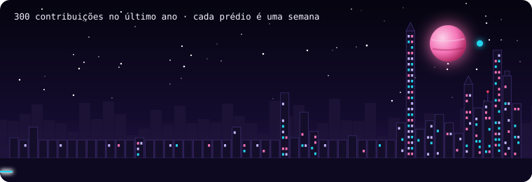

<!-- ==================== CABEÇALHO ==================== -->
<p align="center">👋 Olá, eu sou</p>

<p align="center">
  
</p>

<p align="center">
  
</p>

<!-- 👇 Se quiser o banner do quarto roxo, cole a linha dele aqui embaixo -->


<!-- ==================== SOBRE MIM ==================== -->
<p>
Desenvolvedora Front-End que gosta de transformar ideias em interfaces bonitas, acessíveis e bem construídas.
Venho do desenvolvimento Android com Kotlin e Jetpack Compose — e levo para a web a mesma forma de pensar em componentes e UI declarativa.
Como diferencial, trago experiência prática com IA Generativa e RAG para criar aplicações mais inteligentes. 💜
</p>

👩‍💻 &nbsp;Desenvolvedora Front-End <br/>
⚛️ &nbsp;React.js · JavaScript · HTML & CSS <br/>
📱 &nbsp;Background em Android com Kotlin & Jetpack Compose <br/>
✨ &nbsp;Diferencial: IA Generativa & RAG aplicados a interfaces <br/>
🧠 &nbsp;Formação em IA & RAG pelo Instituto ECOA (PUC-Rio) <br/>
🔎 &nbsp;Experiência prática com RAG aplicado à saúde pública <br/>
🎓 &nbsp;Especialização em Inteligência Artificial <br/>

```bash
> Desenvolvendo soluções. Criando experiências. Evoluindo sempre. </>
```


<!-- ==================== TECNOLOGIAS + COMO EU TRABALHO ==================== -->
<table>
<tr>
<td valign="top" width="58%">

### 🚀 Tecnologias & Ferramentas

**Front-End**<br/>


**Mobile**<br/>


**IA & RAG**<br/>


**Ferramentas**<br/>


</td>
<td valign="top" width="42%">

### 🤝 Como eu trabalho

💜 Componentização e UI declarativa <br/>
💜 Git com branches por tarefa e Pull Requests <br/>
💜 Code review em equipe <br/>
💜 Commits padronizados <br/>
💜 Documentação técnica clara <br/>
💜 Versionamento de dados e reprodutibilidade <br/>
💜 Aprendizado contínuo, um projeto de cada vez

</td>
</tr>
</table>


<!-- ==================== GITHUB STATS ==================== -->
### 📊 GitHub Stats

<p align="center">
  
  
  
</p>


<!-- ==================== CONTRIBUIÇÕES ==================== -->
### 🏙️ Contribuições

<p align="center">
  
</p>


<!-- ==================== ARCADE ==================== -->
### 🎮 Arcade da Paula

<p align="center">
  <a href="https://paula-thamyres.github.io/Paula-Thamyres/jogar/">
    
  </a>
</p>

<p align="center">
  <a href="https://paula-thamyres.github.io/Paula-Thamyres/jogar/">
    
  </a>
</p>

<p align="center"><sub>Quiz de JavaScript · Memória Dev · Xadrez Candy — feitos por mim com HTML, CSS e JavaScript 💜</sub></p>


<!-- ==================== CONTATO ==================== -->
### 💌 Vamos nos conectar?

<p align="center">
  <a href="https://www.linkedin.com/in/paula-femina">
    
  </a>
  <a href="mailto:paula.arthamys@gmail.com">
    
  </a>
</p>

<p align="center">
  
</p>
